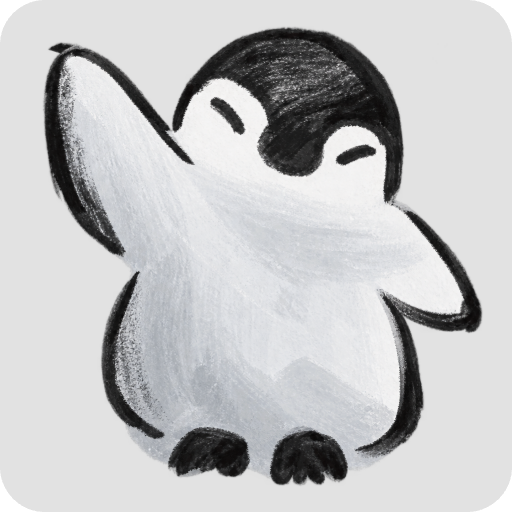

<table>
<tr>
<td width="65%" valign="top">
<pre>
HI I AM
ㅤ
████████╗██╗  ██╗ █████╗ ███╗   ██╗ █████╗ ███████╗     
╚══██╔══╝██║  ██║██╔══██╗████╗  ██║██╔══██╗██╔════╝  
   ██║   ███████║███████║██╔██╗ ██║███████║███████╗     
   ██║   ██╔══██║██╔══██║██║╚██╗██║██╔══██║╚════██║     
   ██║   ██║  ██║██║  ██║██║ ╚████║██║  ██║███████║    
   ╚═╝   ╚═╝  ╚═╝╚═╝  ╚═╝╚═╝  ╚═══╝╚═╝  ╚═╝╚══════╝    
ㅤ
─ ABOUT ME ───────────────────────────────────────────────────────────────
a curious developer & student who enjoys building things, solving problems
and exploring new tech. i do full stack and ai-ml related work mostly but
am always looking to learn something new. Also into OSS contribution kinda
ㅤ
currently trying to build some useful projects and try some research ideas
</pre>

**Connect with me:**

</td>

<td width="29.25%" align="center" valign="middle">
  
</td>
</tr>
</table>

## Tech Stack & Languages

